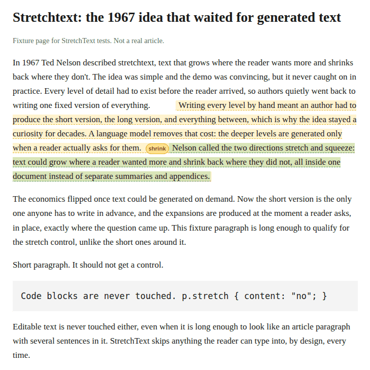

# StretchText for Pollinations

[](https://pollinations.ai/?ref=badge)

Turn any web page into stretchtext. Hover a paragraph, hit **+ stretch**, and a
Pollinations text model grows the passage in place, tinted so you can see what
is grown. Hit **shrink** and the page goes back to exactly what it was. Grown
text can be stretched once more, one level deeper.

Stretchtext is Ted Nelson's 1967 idea: text that grows where the reader wants
more and shrinks back where they don't. Writing every level by hand was too
much work, so it never caught on. Generated text makes it cheap.



The screenshot is the real content script running on the bundled fixture page
(`test/fixtures/article.html`) with the model call mocked. No Pollen was spent
on it.

## Install (load unpacked)

1. Download [stretchtext.zip](https://dextheking1.github.io/stretchtext/stretchtext.zip)
   from the install page and unzip it, or clone this repo.
2. Open `chrome://extensions` in a Chromium browser.
3. Turn on **Developer mode** (top right).
4. Click **Load unpacked** and pick the folder that contains `manifest.json`.
5. Open the extension's options page and connect your Pollen (next section).

## Bring your own Pollen

Readers pay with their own Pollen. The extension ships two routes, both
ending with your key in `chrome.storage.local` on your machine only:

- **Device flow (shipped, per the BYOP guide).** Pollinations calls this out
  for extensions and other apps that cannot show the consent page themselves.
  Options -> "Connect my Pollen" requests a device code from
  `enter.pollinations.ai/api/device/code`, shows you the verification link
  and code, you approve in your browser, and the extension polls
  `/api/device/token` until it receives your scoped `sk_…` key. An app key
  (`pk_…`) can be set in options for attribution; it is optional.
- **Paste a key (fallback).** Paste any Pollinations API key from
  [enter.pollinations.ai/keys](https://enter.pollinations.ai/keys) into the
  options page instead.

Every expansion is a `POST https://gen.pollinations.ai/v1/chat/completions`
with your key in the `Authorization` header, billed to you. Default model is
`openai` (GPT-5.4 Nano); change it in options. No key, no calls: the extension
never ships with one and there is no shared key anywhere in the code.

## How it works

- The content script scans for article paragraphs (120 to 2000 characters, at
  least two sentences) and appends a small **+ stretch** button.
- Clicking it sends the paragraph text to the background worker, which calls
  the model and returns an expansion written in the same voice.
- The expansion is appended inside the paragraph as tinted text. The original
  page nodes are never edited or moved, so **shrink** restores the page
  exactly by removing what was added.
- Depth 2: a **stretch more** button inside grown text expands that text one
  level deeper (tinted green). Depth is capped there on purpose.
- Skipped, always: editable fields, inputs, `pre`/`code` blocks, scripts, and
  anything already grown.

## Development

```
npm test     # unit tests: passage splitting, prompts, device flow, manifest
npm run build  # writes dist/stretchtext.zip and refreshes docs/stretchtext.zip
```

`test/fixtures/article.html` loads the real content script with a stubbed
`chrome` API and a mocked model response, for load and layout checks without
spending Pollen.

## License

MIT. Copyright (c) 2026 Benjamin Kincses.
